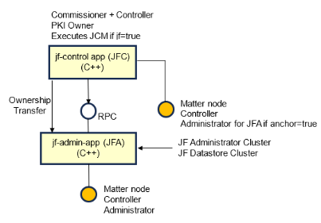

# Joint Fabric Guide

-   [Joint Fabric Guide](#joint-fabric-guide)
    -   [Joint Fabric Example Applications](#joint-fabric-example-applications)
        -   [Building the Example Application](#building-the-example-application)
    -   [Bootstrap Joint Fabric Demo on Linux](#bootstrap-joint-fabric-demo-on-linux)
        -   [Initialize Ecosystem A (Vendor ID = 0xFFF1)](#initialize-ecosystem-a-vendor-id--0xfff1)
        -   [Initialize Ecosystem B (Vendor ID = 0xFFF2)](#initialize-ecosystem-b-vendor-id--0xfff2)
    -   [Manually Testing JCM (Joint Commissioning Method)](#manually-testing-jcm-joint-commissioning-method)
    -   [Controller Supported Commands](#controller-supported-commands)
    -   [Testing Cross-Ecosystem Control](#testing-cross-ecosystem-control)
    -   [Unit Testing Joint Fabric](#unit-testing-joint-fabric)

## Joint Fabric Example Applications

jf-control-app and jf-admin-app example applications are provided to demonstrate
the Joint Fabric feature. You can find them in the examples folder.



jf-control-app acts as a commissioner and control plane for jf-admin-app. It
also acts as a PKI provider. jf-admin-app acts as an administrator and it holds
an instance of the JF Administrator Cluster and of the JF Datastore Cluster.

First app commissioned by jf-control-app has to be the jf-admin-app (`--anchor`
parameter set to `true` has to be used in the `pairing` command). jf-control-app
will set the `CaseAdminSubject` field of the `AddNOC()` commands to its
Administrator CAT (initial version for this CAT is configurable from
CHIPProjectAppConfig.h). There is only one exception to this rule and that is
when the `jf` parameter is used in the `pairing` command; in this case the
`CaseAdminSubject` field is set to the `Anchor CAT` of the jf-admin-app (for
more details, please refer to the Matter specification, Joint Commissioning
Method (JCM) chapter).

When jf-admin-app is commissioned for the first time by the jf-control-app it is
issued a NOC containing the Administrator CAT and the Anchor CAT. Initial
version of these CATs is configurable (see CHIPProjectAppConfig.h)

Once the jf-admin-app has been commissioned, following `pairing` commands on
jf-control-app will execute only the commissioning subset of steps (e.g.:
through NOC issuance), then the ownership is transferred through RPC to the
jf-admin-app that finalizes the commissioning.

### Building the Example Application

-   Building the Joint Fabric Control Application

    [jf-control-app](https://github.com/project-chip/connectedhomeip/tree/master/examples/jf-control-app/README.md)

-   Building the Joint Fabric Admin Application

    [jf-admin-app](https://github.com/project-chip/connectedhomeip/tree/master/examples/jf-admin-app/linux/README.md)

    [jf-admin-app][NXP RW612]:

```
    $ west build -d build_jfa -b frdmrw612 examples/thermostat/nxp --
    -DCONF_FILE_NAME=prj_thread_ftd_wifi_br_ota_jfa.conf
```

## Bootstrap Joint Fabric Demo on Linux

Before following the steps below, cleanup temporary chip files:

```
$ rm -rf /tmp/chip_*
```

### Initialize Ecosystem A (Vendor ID = 0xFFF1)

-   Start jf-admin-app (nothing to be done, jf-admin-app starts automatically
    when OTBR application starts)

-   Start jf-control-app

```
$ cd ~/connectedhomeip/examples/jf-control-app/out/debug
$ rm -rf jfc_a_storage_directory && mkdir jfc_a_storage_directory
$ ./jfc-app --storage-directory jfc_a_storage_directory --commissioner-vendor-id 0xFFF1
```

-   Commission jf-admin-app

```
>>> pairing ble-wifi 1 'SSID' 'PWD' 20202021 3840 --anchor true
```

Check for the following logs on the jf-control-app side:

```
>>> [JF] Anchor Administrator commissioned with sucess
```

Make sure that the NOC issued to jf-admin-app contains an Anchor CAT and an
Administrator CAT:

```
>>> operationalcredentials read nocs 1 0
>>> NOCs: 1 entries
$ [TOO]   NOCs: 1 entries
$ [TOO]     [1]: {
$ [[TOO]       Noc: noc_bytes
$ [TOO]       Icac: icac_bytes
$ [TOO]       FabricIndex: 1
$ [TOO]      }
```

Use
[chip-cert](https://github.com/project-chip/connectedhomeip/tree/master/src/tools/chip-cert/README.md)
for decoding noc_bytes:

```
$ chip-cert convert-cert --x509-pem  noc_bytes - | openssl x509 -inform pem -noout -text
```

Check for the Anchor CAT and Administrator CAT in the Subject Field of the NOC:

```
$ Subject: ..., 1.3.6.1.4.1.37244.1.6 = FFFF0001, 1.3.6.1.4.1.37244.1.6 = FFFE0001
```

Check for the "jf-anchor-icac" inside the Subject Field of the ICAC:

```
$ chip-cert convert-cert --x509-pem  icac_bytes - | openssl x509 -inform pem -noout -text
....
Subject: 1.3.6.1.4.1.37244.1.3 = 0000000000000003, OU = jf-anchor-icac
...
```

-   Perform TBR Commissioning

```
>>> generalcommissioning arm-fail-safe 900 1 1 0
>>> threadborderroutermanagement set-active-dataset-request   hex:0e08000000000001000035060004001fffe00708fd08c3f6c3fe888a04106604c73288a13e244433f173270471490c0402a0f7f8000300000e0102123402081111111122222222030444454d4f051099882233445566770011aabbccddffee 0x1 2 --timedInteractionTimeoutMs 5000
>>> generalcommissioning commissioning-complete 1 0
```

-   Start the MCXW72
    [lighting-app](https://github.com/project-chip/connectedhomeip/blob/master/docs/platforms/nxp/nxp_mcxw72_guide.md)

-   Commission lighting-app

```
>>> pairing ble-thread 2 hex:0e08000000000001000035060004001fffe00708fd08c3f6c3fe888a04106604c73288a13e244433f173270471490c0402a0f7f8000300000e0102123402081111111122222222030444454d4f051099882233445566770011aabbccddffee 20202021 3840
```

Check that a Fabric having `AdminVendorID` set to 0xFFF1 has been installed:

```
>>> operationalcredentials read fabrics 2 0
```

Check that an ACL with Subjects field set to the Administrator CAT of
jf-admin-app has been installed:

```
>>> accesscontrol read acl 2 0
```

A `Subjects` field equal to `18446744065119551489` (`FFFFFFFDFFFF0001` in hex)
should be found.

### Initialize Ecosystem B (Vendor ID = 0xFFF2)

-   Start jf-admin-app

```
$ cd ~/connectedhomeip/examples/jf-admin-app/linux/out/debug
$ rm -rf jfa_b_kvs && touch jfa_b_kvs
$ ./jfa-app --capabilities 0x4 --passcode 11022055 --discriminator 3841 --secured-device-port 5555 --rpc-server-port 33055 --KVS jfa_b_kvs
```

-   Start jf-control-app

```
$ cd ~/connectedhomeip/examples/jf-control-app/out/debug
$ rm -rf jfc_b_storage_directory && mkdir jfc_b_storage_directory
$ ./jfc-app --rpc-server-port 33055 --storage-directory jfc_b_storage_directory --commissioner-vendor-id 0xFFF2
```

-   Commission jf-admin-app

```
>>> pairing onnetwork-long 11 11022055 3841 --anchor true
```

Check for the following logs on the jf-control-app side:

```
>>> [JF] Anchor Administrator commissioned with success
```

Make sure that the NOC issued to jf-admin-app contains an Anchor CAT and an
Administrator CAT:

```
>>> operationalcredentials read nocs 11 0
>>> NOCs: 1 entries
$ [TOO]   NOCs: 1 entries
$ [TOO]     [1]: {
$ [[TOO]       Noc: noc_bytes
$ [TOO]       Icac: icac_bytes
$ [TOO]       FabricIndex: 1
$ [TOO]      }
```

Use
[chip-cert](https://github.com/project-chip/connectedhomeip/tree/master/src/tools/chip-cert/README.md)
for decoding noc_bytes:

```
$ chip-cert convert-cert --x509-pem  noc_bytes - | openssl x509 -inform pem -noout -text
```

Check for the Anchor CAT and Administrator CAT inside the Subject Field of the
NOC:

```
$ Subject: ..., 1.3.6.1.4.1.37244.1.6 = FFFF0001, 1.3.6.1.4.1.37244.1.6 = FFFE0001
```

Check for the "jf-anchor-icac" inside the Subject Field of the ICAC:

```
$ chip-cert convert-cert --x509-pem  icac_bytes - | openssl x509 -inform pem -noout -text
....
Subject: 1.3.6.1.4.1.37244.1.3 = 0000000000000003, OU = jf-anchor-icac
...
```

-   Start the
    [lighting-app](https://github.com/project-chip/connectedhomeip/tree/master/examples/lighting-app/linux/README.md)

```
$ cd ~/connectedhomeip/examples/lighting-app/linux/out/debug
$ rm -rf light_b_kvs && touch light_b_kvs
$ ./chip-lighting-app --capabilities 0x4 --passcode 11022066 --KVS light_b_kvs
```

-   Commission lighting-app

```
>>> pairing onnetwork 22 11022066 --regular 1
```

Check that a Fabric having `AdminVendorID` set to 0xFFF2 has been installed:

```
>>> operationalcredentials read fabrics 22 0
```

Check that an ACL with Subjects field set to the Administrator CAT of
jf-admin-app has been installed:

```
>>> accesscontrol read acl 22 0
```

A `Subjects` field equal to `18446744065119551489` (`FFFFFFFDFFFF0001` in hex)
should be found.

## Manually Testing JCM (Joint Commissioning Method)

Execute all the initialization steps for Ecosystem A and Ecosystem B above.

On the Ecosystem B Joint Fabric Controller application

-   Open Joint Commissioning Window on JF Admin App of Ecosystem B

```
>>> pairing open-joint-commissioning-window 11 1 400 1000 1261
```

Check for the following logs on the jf-admin-app side:

```
>>> [DIS] Advertise commission parameter vendorID=65522 productID=32769 discriminator=1261/04 cm=3 cp=0 jf=14
```

Note: Capture the [manual pairing code]

On the Ecosystem A Joint Fabric Controller application

```
pairing code 10 [manual pairing code] --jcm true
```

## Controller Supported Commands

Once the jf-admin-app has commissioned peer devices onto the joint fabric, it
can act as a controller and send client cluster commands to those nodes. These
commands are exposed through the application shell under the `control` command
and are compiled in when `CONFIG_CHIP_APP_JF_ADMIN` is enabled (default for the
NXP OTBR / jf-admin-app build).

Common arguments:

-   `<nodeId-hex>`: operational Node ID of the target peer on the joint fabric,
    in hexadecimal (e.g. `0x2`).
-   `<endpointId>`: target endpoint on the peer node, in decimal.

The CASE session to the peer is established on demand and released after each
command completes.

### `control onoff` – OnOff cluster

Sends `On`, `Off`, or `Toggle` commands of the `OnOff` cluster.

```
control onoff [on|off|toggle] <nodeId-hex> <endpointId>
```

Examples:

```
>>> control onoff on     0x2 1
>>> control onoff off    0x2 1
>>> control onoff toggle 0x2 1
```

### `control fan` – FanControl cluster

Writes the `FanMode` attribute of the `FanControl` cluster to `On` or `Off`.

```
control fan [on|off] <nodeId-hex> <endpointId>
```

Examples:

```
>>> control fan on  0x3 1
>>> control fan off 0x3 1
```

### `control contact` – BooleanState cluster

Reads the `StateValue` attribute of the `BooleanState` cluster (used by contact
sensors). The result is printed to the shell log as
`true (contact)` / `false (no contact)`.

```
control contact read <nodeId-hex> <endpointId>
```

Example:

```
>>> control contact read 0x4 1
```

### `control level` – LevelControl cluster

Invokes `MoveToLevel` on the `LevelControl` cluster.

```
control level <level 0-254> <transitionTime 1/10s> <nodeId-hex> <endpointId>
```

-   `<level>`: target level, in the range `0`–`254`.
-   `<transitionTime>`: transition time in tenths of a second (`uint16`).

Example (move node `0x2` endpoint `1` to level `128` over 2.0 seconds):

```
>>> control level 128 20 0x2 1
```

## Testing Cross-Ecosystem Control

After the two fabrics have been joined via JCM, each Joint Fabric Controller can
control the lighting-app that was originally commissioned into the other
ecosystem. Ecosystem A owns the lighting-app commissioned as node id 2 and
Ecosystem B owns the lighting-app commissioned as node id 22.

Prerequisites:

-   Both ecosystems have been fully initialized as described in
    [Initialize Ecosystem A](#initialize-ecosystem-a-vendor-id--0xfff1) and
    [Initialize Ecosystem B](#initialize-ecosystem-b-vendor-id--0xfff2),
    including their respective lighting-app (node id 2 on Ecosystem A, node id 22
    on Ecosystem B).
-   The two fabrics have been joined via JCM as described in
    [Manually Testing JCM](#manually-testing-jcm-joint-commissioning-method).

-   Use the Ecosystem A Joint Fabric Controller to toggle the light that belongs
    to Ecosystem B (node id 22):

```
>>> onoff toggle 22 1
```

The On/Off state of the Ecosystem B lighting-app should change. Read back the
OnOff attribute to confirm:

```
>>> onoff read on-off 22 1
```

-   Use the Ecosystem B Joint Fabric Controller to toggle the light that belongs
    to Ecosystem A (node id 2):

```
>>> onoff toggle 2 1
```

The On/Off state of the Ecosystem A lighting-app should change. Read back the
OnOff attribute to confirm:

```
>>> onoff read on-off 2 1
```

If both toggles succeed and are reflected on the targeted lighting-app, the
cross-ecosystem control over the joint fabric is working as expected.

## Unit Testing Joint Fabric

To enable Joint Fabric related unit tests please use the following command:

`gn gen out/test --args="chip_device_config_enable_joint_fabric=true"`
